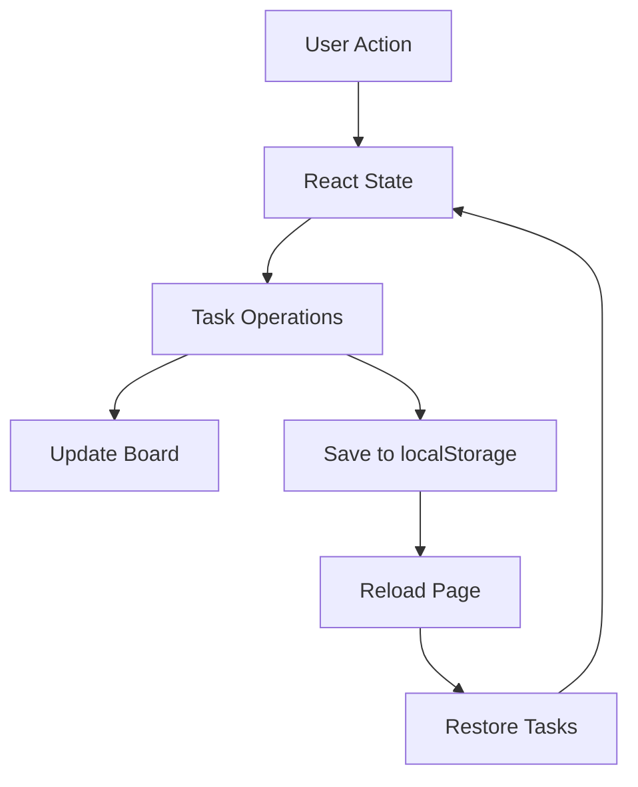

# TASK_m

A simple, responsive Kanban task board built with React, TypeScript, Vite, and modern CSS.

---

## Data Flow Architecture



---

## Features

- **3 Kanban Columns**: `To Do`, `In Progress`, and `Done`.
- **Task Management**: Create, edit, delete, and move tasks between columns.
- **Overdue Highlighting**: Automatic visual highlight for past-due tasks that are not marked Done.
- **Search & Filter**: Real-time case-insensitive title search and assignee filter.
- **Persistence**: Automatically syncs all changes to browser `localStorage`.
- **Responsive**: Side-by-side 3-column layout on desktop; horizontal swipe with touch snap and tabs on mobile.

---

## Tech Stack

- **React 19**
- **TypeScript**
- **Vite**
- **CSS** (Custom properties, Grid, Flexbox)

---

## Getting Started

### 1. Install dependencies
```bash
npm install
```

### 2. Start development server
```bash
npm run dev
```

Open `http://localhost:5173` in your browser.

### 3. Build for production
```bash
npm run build
```

---

## Project Structure

```text
src/
├── components/
│   ├── Board.tsx          # 3-column Kanban board container
│   ├── BoardColumn.tsx    # Single column layout & empty state
│   ├── BoardHeader.tsx    # App header & status counters
│   ├── ConfirmModal.tsx   # Delete / reset confirmation dialog
│   ├── TaskCard.tsx       # Task card with move & action buttons
│   ├── TaskModal.tsx      # Task creation & edit modal
│   ├── TaskToolbar.tsx    # Search input & assignee filter
│   └── icons.tsx          # Inline SVG icons
├── hooks/
│   └── useTasks.ts        # Task state & persistence hook
├── types/
│   └── task.ts            # TypeScript interfaces
├── utils/
│   ├── avatarUtils.ts     # User initials & avatar color generator
│   ├── dateUtils.ts       # Timezone-safe date & overdue checks
│   └── storage.ts         # localStorage sync utility
├── App.tsx                # Main app component
├── index.css              # Styling & design system
└── main.tsx               # App entry point
```

---

